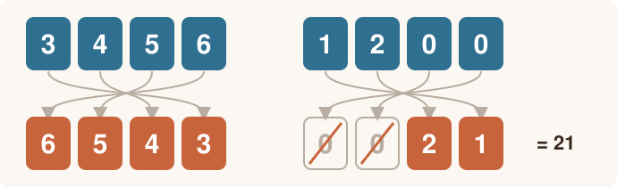

# Cijfers van een getal

<p style="text-align: center;"></p>

## Gegeven

Je krijgt een geheel getal van precies vier cijfers. Het eerste cijfer is nooit `0`.

Het **omgekeerde getal** ontstaat door de vier cijfers in omgekeerde volgorde te zetten.

## Invoer

| Volgorde | Gegeven | Type |
|:--:|:--|:--|
| 1 | een geheel getal van vier cijfers | geheel getal |
{: .table}

## Gevraagd

Het programma bepaalt:

- de som van de vier cijfers;
- het omgekeerde getal;
- de som van het getal en het omgekeerde getal.

{: .callout.callout-warning}
> #### Nullen vooraan
> Het omgekeerde van 1200 is 21, niet 0021.

## Voorbeelden

Bij de invoer:

```text
3456
```

verschijnt:

```text
Som van de cijfers: 18
Omgekeerd getal: 6543
Getal + omgekeerd getal: 9999
```

Bij de invoer:

```text
1200
```

verschijnt:

```text
Som van de cijfers: 3
Omgekeerd getal: 21
Getal + omgekeerd getal: 1221
```

Test je programma eventueel eerst in [Papyros](https://papyros.dodona.be/).
