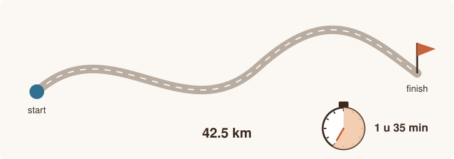

# Fietstocht

<p style="text-align: center;"></p>

## Gegeven

Na een fietstocht wil Mila weten hoe snel ze gereden heeft. Ze kent de afstand in kilometer. De duur van de rit kent ze in uren en minuten.

Het **tempo** is het aantal minuten dat ze gemiddeld nodig had per kilometer.

## Invoer

| Volgorde | Gegeven | Type |
|:--:|:--|:--|
| 1 | de afstand in km | kommagetal |
| 2 | het aantal uren | geheel getal |
| 3 | het aantal minuten | geheel getal |
{: .table}

## Gevraagd

Het programma berekent:

- de totale duur van de rit in minuten;
- de gemiddelde snelheid in km/u;
- het tempo in minuten per km.

{: .callout.callout-info}
> #### Afronden
> De snelheid rond je af op 1 cijfer na de komma, het tempo op 2 cijfers na de komma.

## Voorbeeld

Bij de invoer:

```text
42.5
1
35
```

verschijnt:

```text
Totale tijd: 95 minuten
Gemiddelde snelheid: 26.8 km/u
Tempo: 2.24 minuten per km
```

Test je programma eventueel eerst in [Papyros](https://papyros.dodona.be/).
