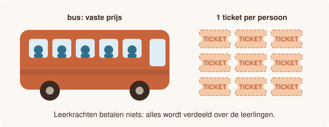

# Klasuitstap

<p style="text-align: center;"></p>

## Gegeven

Een klas gaat op uitstap. Iedereen heeft een toegangsticket nodig, ook de begeleidende leerkrachten. Daarnaast wordt er een bus gehuurd.

De leerkrachten betalen zelf niets. Alle kosten worden eerlijk verdeeld over de leerlingen.

## Invoer

| Volgorde | Gegeven | Type |
|:--:|:--|:--|
| 1 | de bestemming | tekst |
| 2 | het aantal leerlingen | geheel getal |
| 3 | het aantal leerkrachten | geheel getal |
| 4 | de prijs van één toegangsticket in euro | kommagetal |
| 5 | de totale kostprijs van de bus in euro | kommagetal |
{: .table}

## Gevraagd

Het programma berekent de totale kostprijs van de uitstap en het bedrag dat elke leerling moet betalen.

{: .callout.callout-info}
> #### Afronden
> Rond beide bedragen af op 2 cijfers na de komma.

## Voorbeeld

Bij de invoer:

```text
Brugge
24
2
12.5
355
```

verschijnt:

```text
Uitstap naar Brugge.
Totale kostprijs: 680.0 euro
Prijs per leerling: 28.33 euro
```

Test je programma eventueel eerst in [Papyros](https://papyros.dodona.be/).
