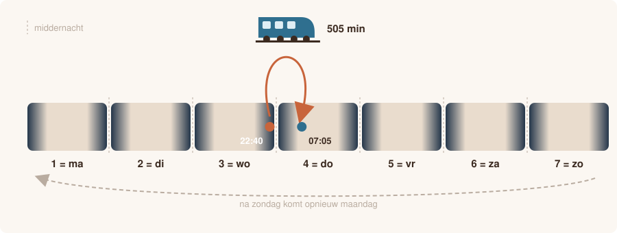

# Nachttrein

<p style="text-align: center;"></p>

## Gegeven

Een internationale nachttrein rijdt soms meerdere dagen. Het reisbureau wil voor elke rit automatisch weten wanneer de trein aankomt en wat een ticket kost.

De dagen van de week worden genummerd: `1` is maandag, `2` is dinsdag, …, `7` is zondag. Na zondag komt opnieuw maandag.

Een ticket kost **4.50 euro** instapkost plus **0.85 euro per begonnen kwartier** reistijd. Een rit van 16 minuten telt dus als 2 kwartieren.

## Invoer

| Volgorde | Gegeven | Type |
|:--:|:--|:--|
| 1 | de vertrekdag (1 tot en met 7) | geheel getal |
| 2 | het vertrekuur (0 tot en met 23) | geheel getal |
| 3 | de vertrekminuut (0 tot en met 59) | geheel getal |
| 4 | de reisduur in minuten | geheel getal |
{: .table}

## Gevraagd

Het programma bepaalt:

- op welke dag en om welk uur de trein aankomt;
- hoe vaak de trein tijdens de rit middernacht passeert;
- de prijs van een ticket, afgerond op 2 cijfers na de komma.

{: .callout.callout-warning}
> #### Uren en minuten met twee cijfers
> De aankomsttijd schrijf je altijd met twee cijfers voor het uur en twee voor de minuten: 7 uur en 5 minuten wordt `07:05`.

{: .callout.callout-info}
> #### Enkel hoofdstuk 1
> Alles kan met de bewerkingen uit hoofdstuk 1. Je hebt geen `import` nodig.

## Voorbeelden

Bij de invoer:

```text
3
22
40
505
```

verschijnt:

```text
Aankomst: dag 4 om 07:05
Middernacht overschreden: 1 keer
Prijs: 33.4 euro
```

Bij de invoer:

```text
7
23
50
15
```

verschijnt:

```text
Aankomst: dag 1 om 00:05
Middernacht overschreden: 1 keer
Prijs: 5.35 euro
```

Test je programma eventueel eerst in [Papyros](https://papyros.dodona.be/).
