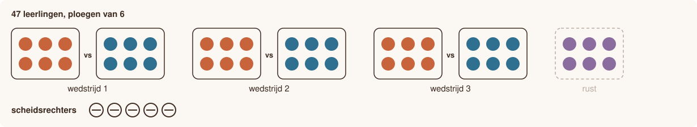

# Sportdag

<p style="text-align: center;"></p>

## Gegeven

Op de sportdag worden de leerlingen verdeeld in ploegen die allemaal even groot zijn. Er worden zoveel mogelijk volledige ploegen gevormd.

Leerlingen die in geen enkele volledige ploeg passen, worden scheidsrechter.

Een wedstrijd wordt altijd door twee ploegen gespeeld. Alle wedstrijden starten tegelijk. Een ploeg die geen tegenstander heeft, rust.

## Invoer

| Volgorde | Gegeven | Type |
|:--:|:--|:--|
| 1 | het aantal leerlingen | geheel getal |
| 2 | het aantal spelers per ploeg | geheel getal |
{: .table}

## Gevraagd

Het programma bepaalt:

- het aantal ploegen;
- het aantal scheidsrechters;
- het aantal wedstrijden dat tegelijk gespeeld wordt;
- het aantal ploegen dat rust.

{: .callout.callout-warning}
> #### Volledige ploegen
> Een ploeg heeft altijd exact het opgegeven aantal spelers.

## Voorbeeld

Bij de invoer:

```text
47
6
```

verschijnt:

```text
Aantal ploegen: 7
Aantal scheidsrechters: 5
Aantal wedstrijden tegelijk: 3
Aantal ploegen dat rust: 1
```

Test je programma eventueel eerst in [Papyros](https://papyros.dodona.be/).
