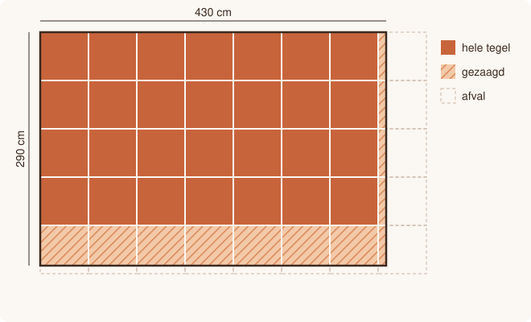

# Terras betegelen

<p style="text-align: center;"></p>

## Gegeven

Een rechthoekig terras wordt betegeld met **vierkante tegels**. Je legt de tegels in rijen, te beginnen in een hoek van het terras.

Waar een tegel niet meer volledig past, wordt hij op maat gezaagd. Een gezaagde tegel telt als één tegel. Het afgezaagde stuk is afval en wordt niet meer gebruikt.

De tegels worden enkel per volledige doos verkocht. Tegels die na het betegelen nog in de dozen zitten, zijn **reservetegels**.

## Invoer

| Volgorde | Gegeven | Type |
|:--:|:--|:--|
| 1 | lengte van het terras in cm | geheel getal |
| 2 | breedte van het terras in cm | geheel getal |
| 3 | zijde van één tegel in cm | geheel getal |
| 4 | aantal tegels in één doos | geheel getal |
| 5 | prijs van één doos in euro | kommagetal |
{: .table}

## Gevraagd

Het programma bepaalt:

- hoeveel tegels er nodig zijn;
- hoeveel daarvan gezaagd moeten worden;
- hoeveel dozen je moet kopen;
- hoeveel reservetegels er overblijven;
- de totale prijs, afgerond op 2 cijfers na de komma.

{: .callout.callout-info}
> #### Let op
> Je mag geen `import math` gebruiken. Alles kan met de bewerkingen die je al kent.

## Voorbeelden

Bij de invoer:

```text
430
290
60
8
34.95
```

verschijnt:

```text
Aantal tegels: 40
Waarvan gezaagd: 12
Aantal dozen: 5
Reservetegels: 0
Totale prijs: 174.75 euro
```

Bij de invoer:

```text
100
100
40
4
12.0
```

verschijnt:

```text
Aantal tegels: 9
Waarvan gezaagd: 5
Aantal dozen: 3
Reservetegels: 3
Totale prijs: 36.0 euro
```

Test je programma eventueel eerst in [Papyros](https://papyros.dodona.be/).
