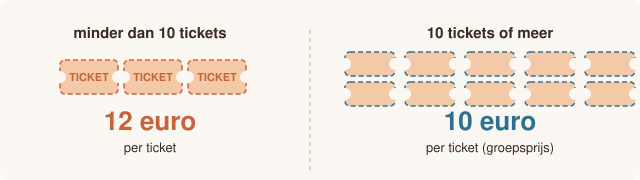

# Fuifticket

<p style="text-align: center;"></p>

## Gegeven

De leerlingenraad organiseert een fuif. Een ticket kost **12 euro**.

Wie **10 tickets of meer** in één keer koopt, krijgt de groepsprijs: dan kost elk ticket **10 euro**.

## Invoer

| Volgorde | Gegeven | Type |
|:--:|:--|:--|
| 1 | het aantal tickets | geheel getal |
{: .table}

## Gevraagd

Het programma toont de prijs per ticket en het totale bedrag.

Bij de groepsprijs toont het programma ook hoeveel euro je bespaart tegenover de gewone prijs.

## Voorbeelden

### Voorbeeld 1

Bij de invoer:

```text
3
```

verschijnt:

```text
Prijs per ticket: 12 euro
Totaal te betalen: 36 euro
```

### Voorbeeld 2

Bij de invoer:

```text
10
```

verschijnt:

```text
Prijs per ticket: 10 euro
Totaal te betalen: 100 euro
Je bespaart 20 euro dankzij de groepsprijs.
```

Test je programma eventueel eerst in [Papyros](https://papyros.dodona.be/).
