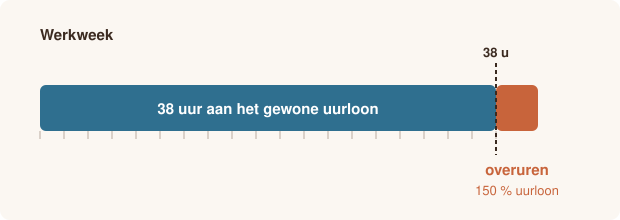

# Jobstudent

<p style="text-align: center;"></p>

## Gegeven

Lotte werkt tijdens de vakantie als jobstudent. Haar werkgever houdt bij hoeveel **minuten** ze in een week gewerkt heeft.

De eerste **38 uur** worden betaald aan het gewone uurloon. Alles wat ze daarboven werkt, zijn **overuren**. Overuren worden betaald aan **150 %** van het uurloon.

## Invoer

| Volgorde | Gegeven | Type |
|:--:|:--|:--|
| 1 | het aantal gewerkte minuten | geheel getal |
| 2 | het uurloon in euro | kommagetal |
{: .table}

## Gevraagd

Het programma toont de gewerkte tijd in uren en minuten.

Heeft Lotte overuren gedaan, dan toont het programma ook de overuren in uren en minuten. Anders meldt het dat er geen overuren zijn.

Tot slot toont het programma het loon voor die week, afgerond op 2 cijfers na de komma.

## Voorbeelden

### Voorbeeld 1

Bij de invoer:

```text
2490
14.0
```

verschijnt:

```text
Gewerkt: 41 u 30 min
Overuren: 3 u 30 min
Loon: 605.5 euro
```

### Voorbeeld 2

Bij de invoer:

```text
1500
13.5
```

verschijnt:

```text
Gewerkt: 25 u 0 min
Geen overuren.
Loon: 337.5 euro
```

Test je programma eventueel eerst in [Papyros](https://papyros.dodona.be/).
