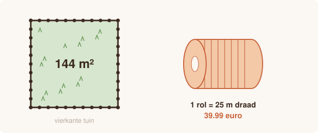

# Omheining

<p style="text-align: center;"></p>

## Gegeven

Rond een **vierkante** tuin komt een omheining van draad. Je kent enkel de oppervlakte van de tuin.

Draad wordt verkocht per rol van **25 meter**. Eén rol kost **39.99 euro**. Je kan enkel volledige rollen kopen.

## Invoer

| Volgorde | Gegeven | Type |
|:--:|:--|:--|
| 1 | de oppervlakte van de tuin in m² | kommagetal |
| 2 | je budget in euro | kommagetal |
{: .table}

## Gevraagd

Het programma bepaalt:

- de omtrek van de tuin;
- hoeveel rollen draad je nodig hebt;
- wat die rollen kosten.

Daarna bepaalt het programma of je budget volstaat. Het toont hoeveel geld je overhoudt of hoeveel je tekortkomt.

{: .callout.callout-info}
> #### Afronden
> De omtrek rond je af op 1 cijfer na de komma, de bedragen op 2 cijfers na de komma.

## Voorbeelden

### Voorbeeld 1

Bij de invoer:

```text
144
100
```

verschijnt:

```text
Omtrek: 48.0 m
Aantal rollen: 2
Kostprijs: 79.98 euro
Je budget volstaat. Je houdt 20.02 euro over.
```

### Voorbeeld 2

Bij de invoer:

```text
400
150
```

verschijnt:

```text
Omtrek: 80.0 m
Aantal rollen: 4
Kostprijs: 159.96 euro
Je budget is te klein. Je komt 9.96 euro tekort.
```

Test je programma eventueel eerst in [Papyros](https://papyros.dodona.be/).
