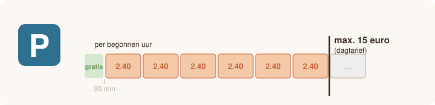

# Parkeergarage

<p style="text-align: center;"></p>

## Gegeven

In de parkeergarage van het stadscentrum gelden deze tarieven:

- Wie **30 minuten of minder** blijft, parkeert gratis.
- Wie langer blijft, betaalt **2.40 euro per begonnen uur**, gerekend vanaf de aankomst.
- Je betaalt nooit meer dan het **dagtarief van 15 euro**.

Aankomst en vertrek vallen op dezelfde dag.

## Invoer

| Volgorde | Gegeven | Type |
|:--:|:--|:--|
| 1 | het uur van aankomst | geheel getal |
| 2 | de minuut van aankomst | geheel getal |
| 3 | het uur van vertrek | geheel getal |
| 4 | de minuut van vertrek | geheel getal |
{: .table}

## Gevraagd

Het programma toont hoe lang de auto geparkeerd stond, in uren en minuten.

Daarna toont het programma wat de bestuurder moet betalen.

{: .callout.callout-info}
> #### Afronden
> Rond het te betalen bedrag af op 2 cijfers na de komma.

## Voorbeelden

### Voorbeeld 1

Bij de invoer:

```text
8
50
10
55
```

verschijnt:

```text
Parkeerduur: 2 u 5 min
Te betalen: 7.2 euro
```

### Voorbeeld 2

Bij de invoer:

```text
9
15
9
45
```

verschijnt:

```text
Parkeerduur: 0 u 30 min
Gratis parkeren!
```

### Voorbeeld 3

Bij de invoer:

```text
7
30
13
31
```

verschijnt:

```text
Parkeerduur: 6 u 1 min
Te betalen: 15.0 euro (dagtarief)
```

Test je programma eventueel eerst in [Papyros](https://papyros.dodona.be/).
