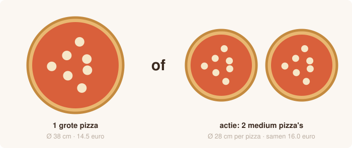

# Pizzadeal

<p style="text-align: center;"></p>

## Gegeven

Een pizzeria verkoopt een **grote pizza**. Er loopt ook een actie: **2 medium pizza's** voor één prijs.

Wat is het voordeligst? Dat hangt af van hoeveel pizza je krijgt voor je geld. Daarom vergelijk je de prijs per **100 cm²** pizza. Alle pizza's zijn perfect rond.

## Invoer

| Volgorde | Gegeven | Type |
|:--:|:--|:--|
| 1 | de diameter van de grote pizza in cm | kommagetal |
| 2 | de prijs van de grote pizza | kommagetal |
| 3 | de diameter van één medium pizza in cm | kommagetal |
| 4 | de prijs voor de 2 medium pizza's samen | kommagetal |
{: .table}

## Gevraagd

Het programma bepaalt:

- de oppervlakte van de grote pizza;
- de oppervlakte van de 2 medium pizza's samen;
- de prijs per 100 cm² voor beide keuzes.

Daarna bepaalt het programma welke keuze het voordeligst is. Zijn beide even voordelig, dan kies je de grote pizza.

{: .callout.callout-info}
> #### Afronden
> Rond de oppervlaktes af op 1 cijfer na de komma en de prijzen per 100 cm² op 2 cijfers. Vergelijk de prijzen vóór je ze afrondt.

{: .callout.callout-warning}
> #### Schrijfwijze
> In de uitvoer schrijf je `cm2` in plaats van cm².

## Voorbeelden

### Voorbeeld 1

Bij de invoer:

```text
38
14.5
28
16.0
```

verschijnt:

```text
Oppervlakte grote pizza: 1134.1 cm2
Oppervlakte 2 medium pizza's: 1231.5 cm2
Grote pizza: 1.28 euro per 100 cm2
2 medium pizza's: 1.3 euro per 100 cm2
Beste keuze: de grote pizza
```

### Voorbeeld 2

Bij de invoer:

```text
33
12.0
25
13.5
```

verschijnt:

```text
Oppervlakte grote pizza: 855.3 cm2
Oppervlakte 2 medium pizza's: 981.7 cm2
Grote pizza: 1.4 euro per 100 cm2
2 medium pizza's: 1.38 euro per 100 cm2
Beste keuze: 2 medium pizza's
```

Test je programma eventueel eerst in [Papyros](https://papyros.dodona.be/).
