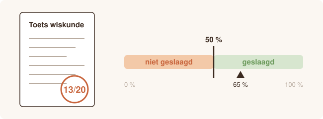

# Wiskundetoets

<p style="text-align: center;"></p>

## Gegeven

Na een toets wil je weten welk percentage je behaalde. Je bent geslaagd vanaf **50 %**.

Ben je niet geslaagd, dan wil je ook weten hoeveel punten je nog nodig had om precies de helft te halen.

## Invoer

| Volgorde | Gegeven | Type |
|:--:|:--|:--|
| 1 | de behaalde punten | kommagetal |
| 2 | het maximum van de toets | geheel getal |
{: .table}

## Gevraagd

Het programma berekent het percentage en bepaalt of je geslaagd bent.

Ben je niet geslaagd, dan toont het programma hoeveel punten je nog nodig had.

{: .callout.callout-info}
> #### Afronden
> Rond het percentage en het aantal punten af op 1 cijfer na de komma.

## Voorbeelden

### Voorbeeld 1

Bij de invoer:

```text
13
20
```

verschijnt:

```text
Percentage: 65.0 %
Geslaagd!
```

### Voorbeeld 2

Bij de invoer:

```text
8.5
20
```

verschijnt:

```text
Percentage: 42.5 %
Niet geslaagd. Je had nog 1.5 punten nodig.
```

Test je programma eventueel eerst in [Papyros](https://papyros.dodona.be/).
